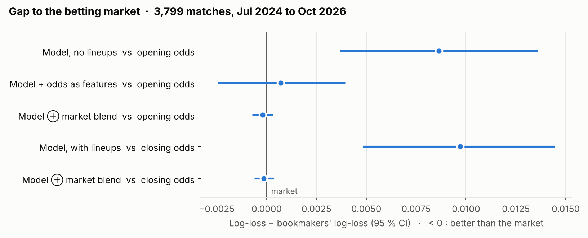
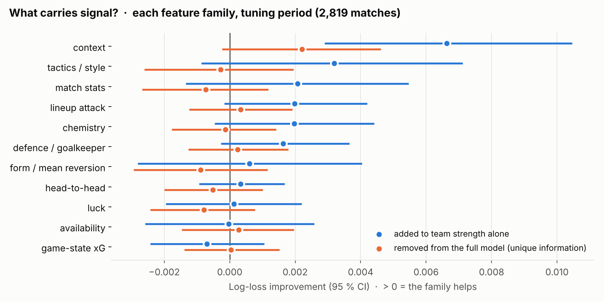
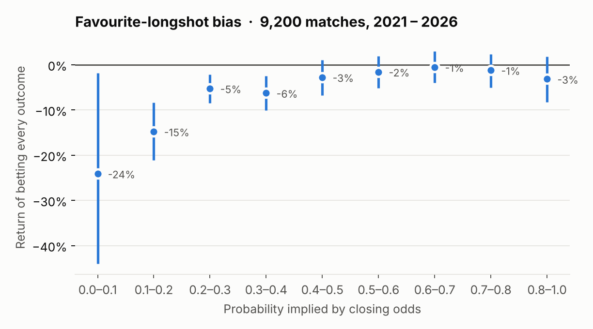
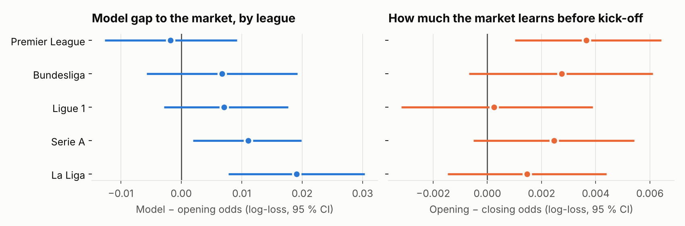

# Can public football data beat the betting market?

**A leakage-audited, walk-forward study of match forecasting in the Big-5 European leagues (2021 – 2026)**

   

*Version française : [README.fr.md](README.fr.md)*

I built a complete pipeline — data collection, 220 hand-designed features, gradient-boosted
models, a lineup transformer — to predict football match outcomes, and evaluated it the way a
forecaster should be evaluated: **on ~3,800 matches it never saw while being designed or tuned,
against the betting market that had exactly the same information.**

The short answer is **no**: the model is good — far better than a classic Dixon-Coles model — but
the market is better still, and the model adds no information the market does not already price.
The more interesting answers are in *why*, and in the pitfalls found on the way.

## Key findings

| | |
|---|---|
| **The model is strong…** | log-loss **0.978** vs **0.992** for Dixon-Coles and **1.074** for a constant baseline |
| **…but the market is stronger** | opening odds **0.970**, closing odds **0.968**; the model is significantly worse (+0.009, 95 % CI [+0.004, +0.014]) |
| **It adds nothing to the market** | blend weights learned on the tuning period: **0.06** for the model vs 0.98 for the odds; the blend ties the market (−0.0002, 95 % CI [−0.0007, +0.0003]) |
| **No betting edge** | the model alone has negative closing-line value (−2 % to −9 %) and negative returns at every threshold |
| **Line-ups barely matter** | knowing the starting XI improves log-loss by only 0.001 (not significant) |
| **What carries signal** | only **match context** (stakes, European fixtures, rest, managerial changes, squad age) helps significantly on its own (+0.007 log-loss); tactics, line-up attack, chemistry, defence and match stats add ~0.002 each but overlap; form, head-to-head, luck, availability and game-state xG add nothing |
| **Market biases** | a clear **favourite-longshot bias**: outcomes priced under 10 % happen 6 % of the time (−24 % return), favourites lose only 1–3 % |
| **Methodological trap** | measuring closing-line value with proportional de-vigging shows a spurious **+10.7 %** edge; the power method gives **−0.4 %** |

<p align="center"></p>

## Why this project is rigorous

* **Strict temporal discipline.** Features are produced by one chronological replay of every
  match; simultaneous kick-offs are written before any of them updates the state.
* **Walk-forward evaluation.** Refit every two months on the past only; hyper-parameters,
  calibration and blend weights are chosen on a separate tuning period (Jan 2023 – Jun 2024);
  the evaluation period (Jul 2024 – Oct 2026) is never used for any decision.
* **Fair market comparison.** Models without line-ups are compared with *opening* odds, models
  with line-ups with *closing* odds — never a model with information the market did not have.
* **Automated leakage audit** (`make leakage`): rebuilding features on truncated data or without
  one simultaneous match must change nothing — it doesn't, over 14,080 rows and 154,857 player
  tokens.
* **Every comparison has a confidence interval** (paired bootstrap over matches).
* **Bugs are documented, not hidden.** Five leakage or measurement bugs were found and fixed;
  they are listed in [docs/METHODOLOGY.md](docs/METHODOLOGY.md#bugs-found-and-fixed-during-the-project).

## Results

### Forecast quality — evaluation period, 3,799 matches with complete odds

| Forecaster | Information | Log-loss ↓ | Brier ↓ |
|---|---|---|---|
| Constant (base rates) | — | 1.0740 | 0.6500 |
| Dixon-Coles, goals only, refit monthly | past goals | 0.9923 | 0.5913 |
| LightGBM, 164 features | before line-ups | 0.9784 | 0.5825 |
| LightGBM, 220 features | with line-ups | 0.9774 | 0.5818 |
| LightGBM + opening odds as features | before line-ups | 0.9705 | 0.5771 |
| Bookmakers, opening | before line-ups | 0.9698 | 0.5770 |
| Model ⊕ opening market blend | before line-ups | 0.9696 | 0.5769 |
| Bookmakers, closing | with line-ups | 0.9677 | 0.5756 |
| Model ⊕ closing market blend | with line-ups | 0.9675 | 0.5755 |

### An exploratory signal — not a result

One betting rule stands out: the model ⊕ market blend, betting at the **best available opening
price** when it exceeds the blend's fair odds by 2 %, gives +9.2 % return (95 % CI [+1.6 %, +17.1 %])
and +2.6 % CLV over 622 bets. I do **not** claim an edge from it: dozens of rules were tested (one
or two are expected to look significant by chance), the "best price" probably includes Betfair
Exchange prices whose commission is not modelled, and the model's weight in the blend is tiny.
It is the first thing a forward paper-trading test should check.

### What kinds of statistics matter?

Each family is added to team strength alone (blue) or removed from the full model (orange),
inside the walk-forward protocol on the tuning period only. All 220 features together improve on
team strength alone by 0.006 (0.988 → 0.982), but only the context family carries information that
no other family already provides.

<p align="center"></p>

### The market

<p align="center">


</p>

* The model is closest to the market in the Premier League and furthest in La Liga and Serie A.
* Odds sharpen between opening and kick-off mostly in the Premier League; in Ligue 1 opening odds
  are already as accurate as closing ones.
* Betting systematically on big clubs breaks even (+0.2 %) while betting against them loses 14 %,
  consistent with the favourite-longshot bias.

Full numbers: [`results/wf_rapport.txt`](results/wf_rapport.txt) (model vs market, betting
simulation, CLV) and [`results/market_study.txt`](results/market_study.txt) (market efficiency).

## Reproduce

```bash
git clone https://github.com/tristan-mrtn/football-markets-ml && cd football-markets-ml
python -m venv .venv && source .venv/bin/activate
pip install -r requirements.txt

make test        # 18 unit tests, no data needed (< 5 s)
make data        # download the raw data (~1–2 h, deliberately rate-limited)
make features    # 220 leakage-free features (~3 min)
make leakage     # automated leakage audit (~8 min)
make evaluate    # walk-forward evaluation (~25 min, 2 CPU cores)
make report market ablation figures
```

Raw data are **not** redistributed; `make data` re-downloads them. Everything runs on a laptop
CPU; no GPU is needed.

## Repository structure

```
footpred/
  data/          understat.py · wikipedia.py · parse_wikipedia.py · wikidata.py · weather.py · ages.py · odds.py
  features/      build.py (chronological replay, 220 features) · families.py
  models/        dixon_coles.py · transformer.py (experimental)
  evaluation/    common.py · walk_forward.py · report.py · market_study.py · ablation.py · leak_tests.py
tests/           unit tests (de-vigging, score model, formations, game state, families, Dixon-Coles)
scripts/         make_figures.py
docs/            METHODOLOGY.md · figures/
results/         all reported numbers (small CSV / TXT files)
```

## Data and licences

| Source | Used for | Terms |
|---|---|---|
| Understat | match & player xG, shots, line-ups, pressing | scraped politely, not redistributed |
| football-data.co.uk | odds (opening & closing, per bookmaker), match stats | free for personal / research use, not redistributed |
| Wikipedia | European fixtures, managerial changes | CC BY-SA |
| Wikidata | stadium coordinates, birth dates | CC0 |
| Open-Meteo | weather | CC BY 4.0 |

## Limitations and next steps

* No defensive event data (tackles, interceptions); domestic cups missing from fatigue features.
* French-licensed bookmakers are absent from the odds; exchange commissions are not modelled.
* Next: per-bookmaker analysis with Betfair Exchange as reference, a forward "paper-trading" test
  on matches played after the model was frozen, and a small language model reading pre-match news.

## Transparency

This project was developed with the help of **Claude Opus 5.5** (Anthropic), which, for the sake of
optimisation, wrote most of the code and documentation under my direction. I defined the project
and its goals, proposed the football hypotheses to test (injuries, player chemistry, formations,
mean reversion…), required the rigorous out-of-sample protocol and the market comparison, and
reviewed the results.

## Citation

See [CITATION.cff](CITATION.cff). Code released under the [MIT licence](LICENSE).
This is a research project: nothing here is betting advice.
